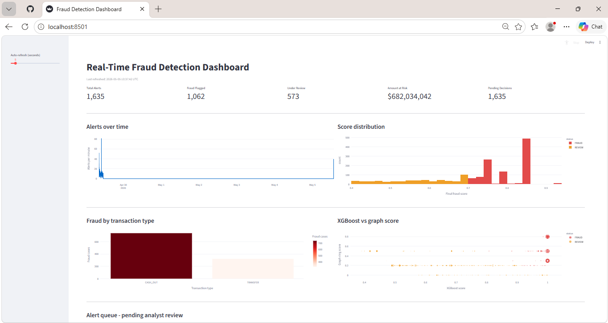
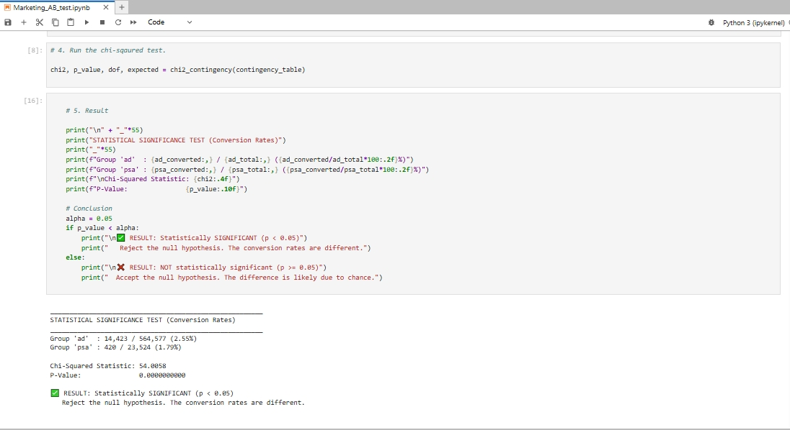
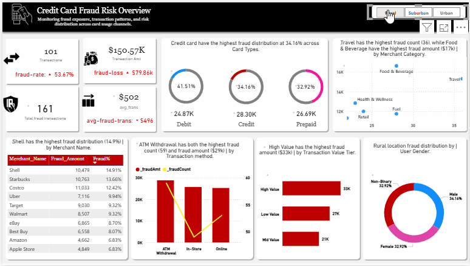
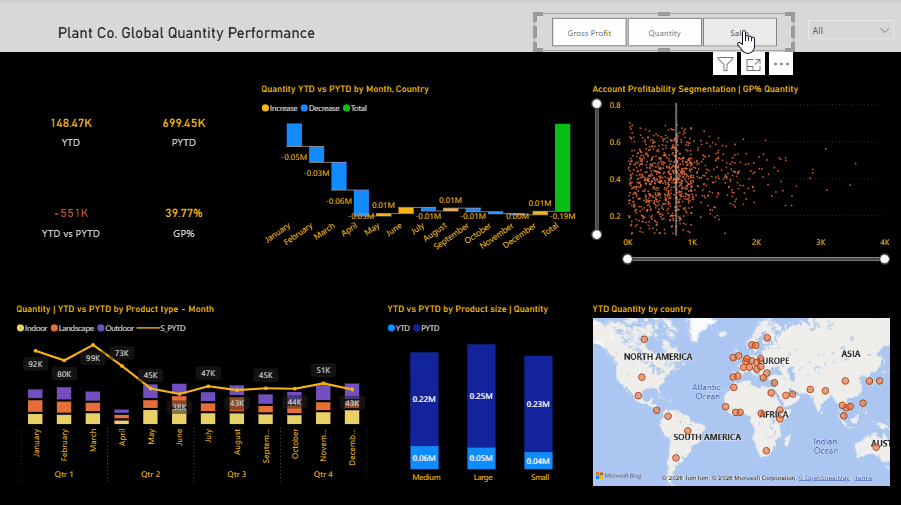
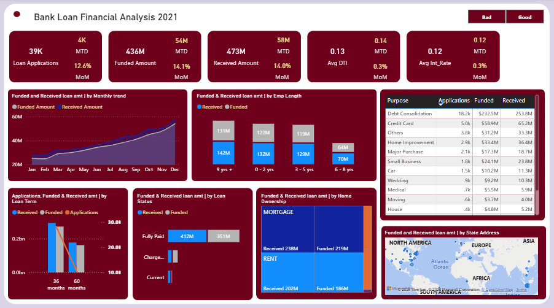
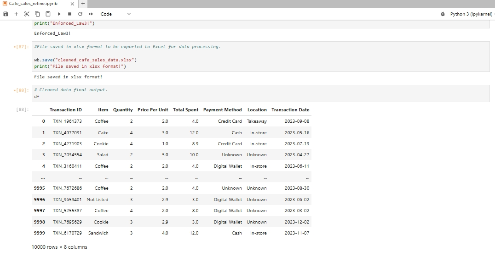
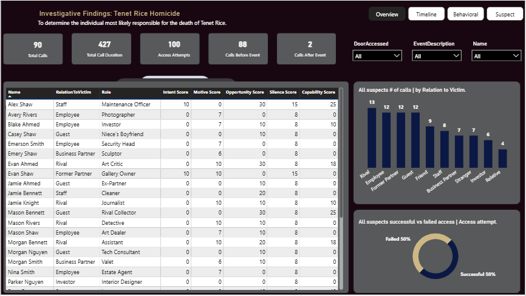
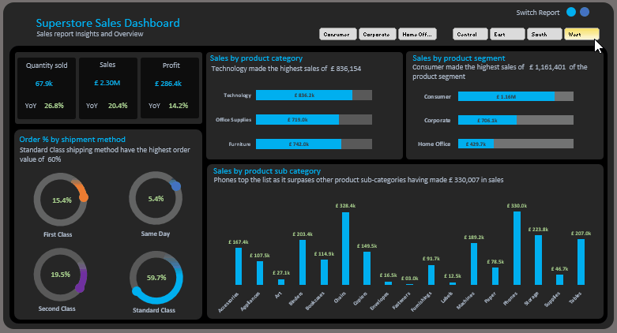

<h1 align="center">Hi, I'm Alabi Ibrahim</h1>

  <b>Turn data into insights, and insights into impact.</b> 
  <a href="mailto:alabi0147@gmail.com">Email</a> |
  <a href="https://www.linkedin.com/in/alabi-ibrahim-73332b236">LinkedIn</a> 

---

## About Me

I am a data analyst who turns messy datasets into clear, decision-ready insights for startups and growing teams.

I work primarily with Python, SQL, Power BI, Excel, and Tableau. My focus sits at the intersection of analysis, modeling, and practical delivery: real-time pipelines, A/B testing, fraud detection, and interactive dashboards that stakeholders actually use.

Recent work includes:

- Designing and shipping a production-style real-time fraud detection system (Kafka, Docker, XGBoost, SHAP, Streamlit) that scored 6.36M transactions at 0.9999 ROC-AUC, 89% precision, 95% recall, and under 50ms latency. Pipeline re-engineering cut processing time 95% and lifted throughput 85%.
- Leading a full marketing A/B test on 588K+ records that showed a statistically significant 2.55% vs 1.79% conversion lift and guided budget reallocation.
- Building Power BI fraud and loan intelligence dashboards that surfaced $79.86K in losses, high-risk segments, and portfolio risk metrics for analyst and lender audiences.

Professionally I work as a freelance data analyst supporting a Norway-based retail startup. There I standardized financial datasets (cutting recurring errors 40%), automated Power BI reporting (improving efficiency 20%), and delivered sales performance dashboards tied to a 14% year-over-year profit improvement. Earlier I interned with Excelerate, supporting campaign analysis that informed an estimated 18% reduction in underperforming ad spend.

I hold the Google Data Analytics and IBM Data Analyst Professional Certificates and maintain a public portfolio of end-to-end projects.

Open to freelance, contract, and (remote) full-time opportunities where clean data and measurable impact matter.

---

## Featured Projects

<!--Section 2: List 3-4 key projects-->

*A glimpse of some of the projects I've been working on.*

**Real Time Fraud Detection System - Identifying live fraud behavioral patterns.**

This project creates a real-time, production-grade fraud detection system from scratch that includes explainability, data streaming, machine learning, graph analysis, and a live analyst dashboard.

[Read More](https://alabiibrahim.github.io/Real_Time_Fraud_Detection_System/)

---

**Marketing A/B Testing - Ad vs PSA Conversion Analysis.**

Analyzed a 588K-user marketing A/B test in SQL/Python; chi-square testing confirmed ads lifted conversion to 2.55% vs. 1.79% control (p<0.005), driving data-backed ad-spend recommendations.

[Read More](https://alabiibrahim.github.io/Marketing_AB_Testing/)

---

**Business Intelligence Report - Identifying $1.62m in high value growth | Excel.**

I built this interactive dashboard to pinpoint revenue drivers across 300 customers and 50 product lines. Featuring granular weekly distribution and quarterly YoY comparisons, it provides the executive clarity needed to scale the £48.5k average revenue per customer through data-backed inventory and marketing shifts.

[Read More](https://alabiibrahim.github.io/Business-Sales-Intelligence-Report/)

---

**Credit Card Fraud Risk Analysis - Uncovers where, when and whom credit card fraud happens most. | SQL & Power BI.**

Power BI dashboard that uncovers where, when, and to whom credit card fraud happens most, turning raw transaction data into clear insights and practical fraud-prevention recommendations.

[Read More](https://alabiibrahim.github.io/Credit-Card-Fraud-Risk-Analysis/)

---

**Plant Co. Performance - $13m revenue tracked across 6 continents | Excel, Power BI.**

Delivered actionable insights on profitability, product segmentation, and geographic performance using advanced visualizations. Achieved a 39.62% gross profit margin and identified a $512K YoY dip with month-by-month breakdowns. Built with precision to support executive decision-making and strategic planning.

[Read More](https://alabiibrahim.github.io/Plant-Co.-Global-Performance/)

---

**Bank Loan Intelligence System - Analyzes over $435m in loan | SQL, Power BI.**

Developed a comprehensive Bank Loan Intelligence System that analyzes over $435M in loan data to monitor portfolio health and borrower risk. By visualizing key metrics like a 13.3% average DTI and identifying Debt Consolidation as the primary loan driver, this project provides actionable insights to improve lending strategies and maintain a 86.2% Good Loan rate.

[Read More](https://alabiibrahim.github.io/Bank-Loan-Intelligence-System/)

---

**Industry Database Design - Scalability, Security, Maintainability | SQL (SSMS).**

This project is a complete SQL Server based relational database designed to handle the core backend requirements of a modern digital platform. This database follows industry best practices for security, scalability and maintainability that companies like Google uses.

[Read More](https://alabiibrahim.github.io/Industry-Database-Design---SQL/)

---

**Data Cleaning - Python**

Cleaned and transform xlsx raw data to csv using Python - pandas, numpy and openpyxl. This cleaned data is ready for analysis and machine learning purpose.

[Readmore](https://alabiibrahim.github.io/Data-Cleaning---Python/)

---

**Forensic Report - Identified the probable perpetrator of Tenet Rice homicide | Power BI.**

The objective of this forensic report is to systematically analyze physical, digital, and testimonial evidence to reconstruct the events of the Tenet Rice homicide and provide an unbiased foundation for legal and investigative decision-making.

[Read More](https://alabiibrahim.github.io/Forensic-Report-Tenet-Rice-Homicide/)

---

**Sales & Marketing Performance Dashboard - Reduced call abandonment by 15% | Excel**

Developed a comprehensive call center intelligence dashboard to track 200k+ annual calls. This tool enables real-time monitoring of agent productivity, regional demand, and conversion rates.

[Readmore](https://alabiibrahim.github.io/Sales-Call-Marketing-Center/)

---

**Superstore Sales Report - Increase sales by 20% and YoY profit by 14.2% | Excel**

To identify top-performing product lines, customer segments, and shipping methods in order to maximize profit growth and streamline sales strategy. 

[Read More](https://alabiibrahim.github.io/Superstore-Sales-Report/)

---

#### 🛠 Technical Skills 
- **SQL** (SSMS)
- **Excel** (Advance Functions, Power Query, VBA)
- **Python** (Pandas, Matplotlib)
- **Power BI** (DAX, Visualization)
- **Tableau** (Visualization, Calculated Fields)

#### 🧠 Soft Skills
- **Problem Solving**
- **Critical Thinking**
- **Effective Communication**
- **Team Collaboration**
- **Curiosity**

#### 🎓 Certifications

- **Microsoft Certified: Power BI Data Analyst Associate**
- **Google Data Analytics Professional Certificate**
- **Excelerate Data Analytics Internship Program**
- **Accenture Job Simulation**

### CONTACT DETAILS

*Let’s connect and see how we can make a difference together!*
<table>
  <tbody>
    <tr>
      <td>📧</td>
      <td><a href="mailto:alabi0147@gmail.com">alabi0147@gmail.com</a></td>
    </tr>
    <tr>
      <td>📞</td>
      <td>(234) 0902-7929-795</td>
    </tr>
    <tr>
      <td>📍</td>
      <td>Lagos, Nigeria GMT+1</td>
    </tr>
    <tr>
      <td>⬇️</td>
      <td><a href="https://github.com/alabiibrahim/myportfolio/blob/main/Resume/Alabi_Ibrahim_resume.pdf">Resume</a></td>
    </tr>
    <tr>
      <td>🌐</td>
      <td><a href="https://www.linkedin.com/in/alabi-ibrahim-73332b236">LinkedIn</a></td>
    </tr>
  </tbody>
</table>

---

  <i>“Without data, you're just another person with an opinion.” — W. Edwards Deming</i>

